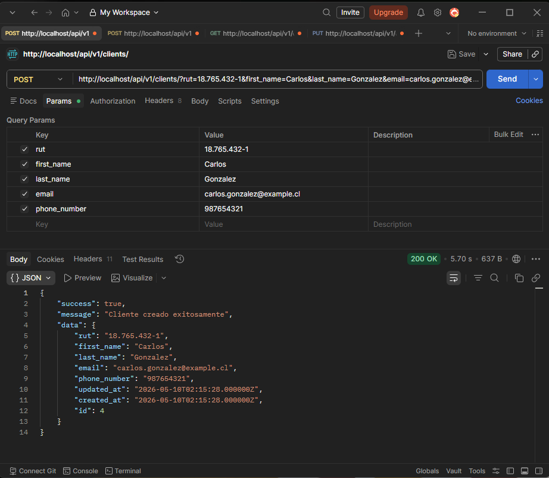
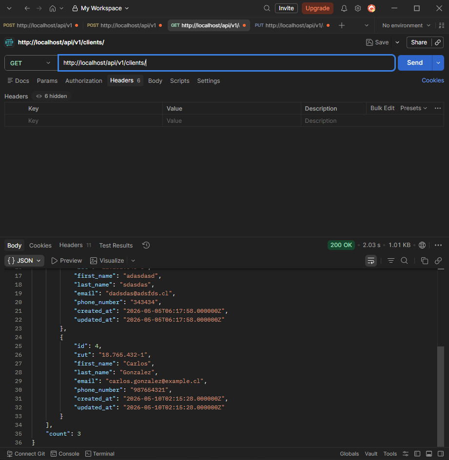
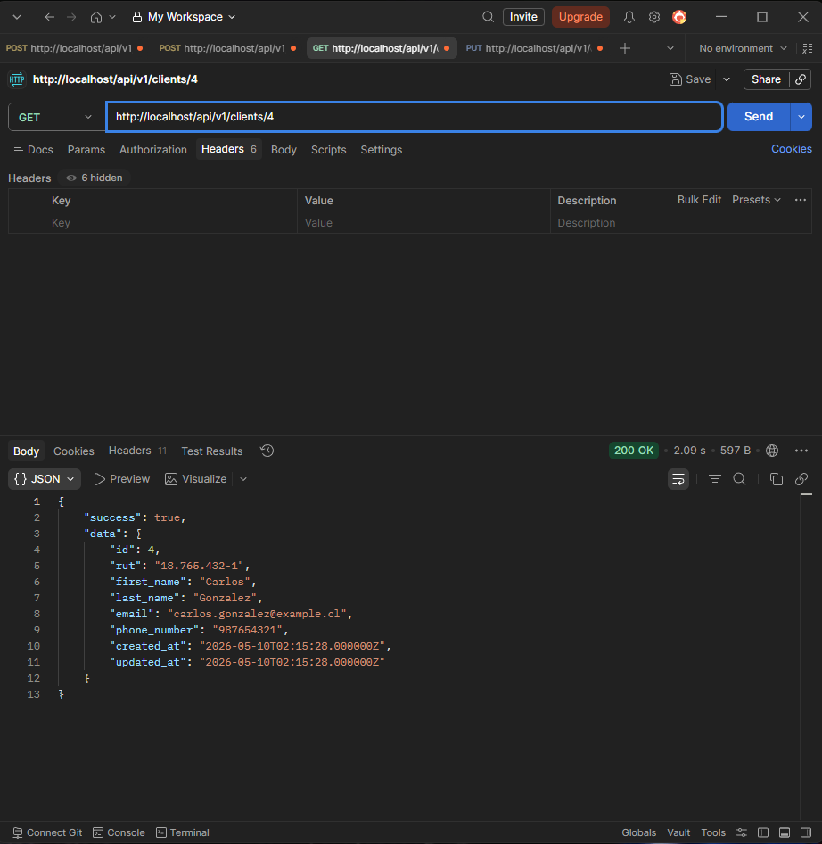
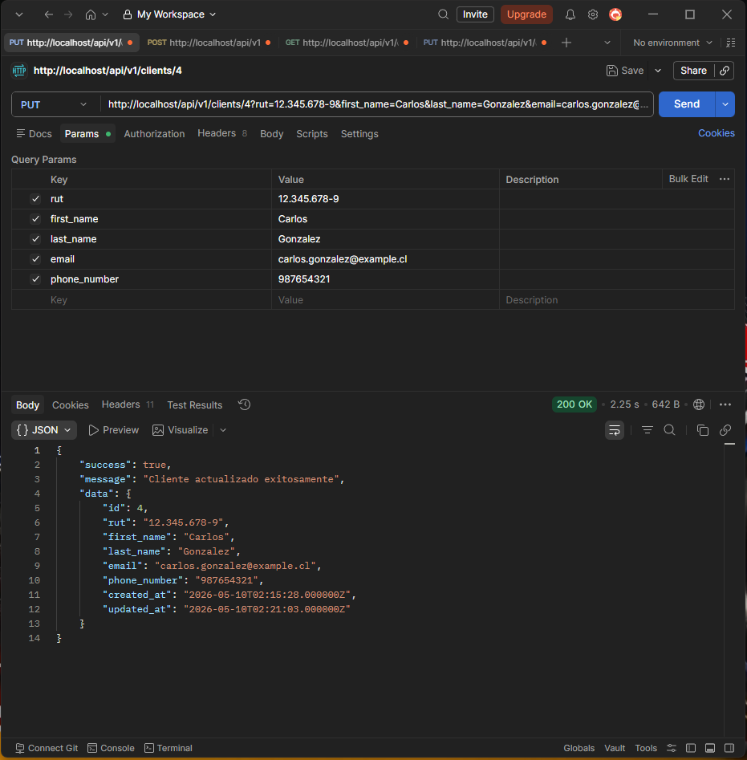
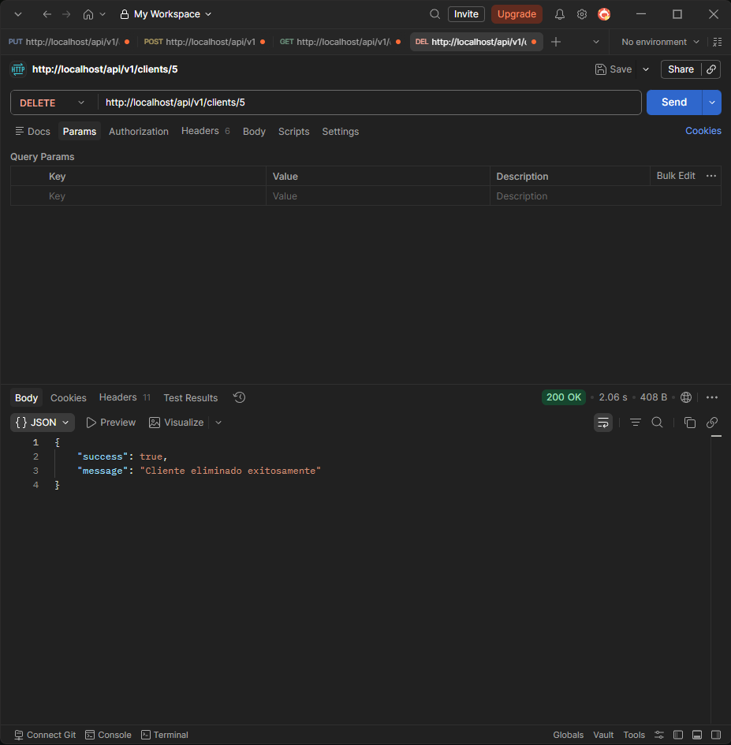
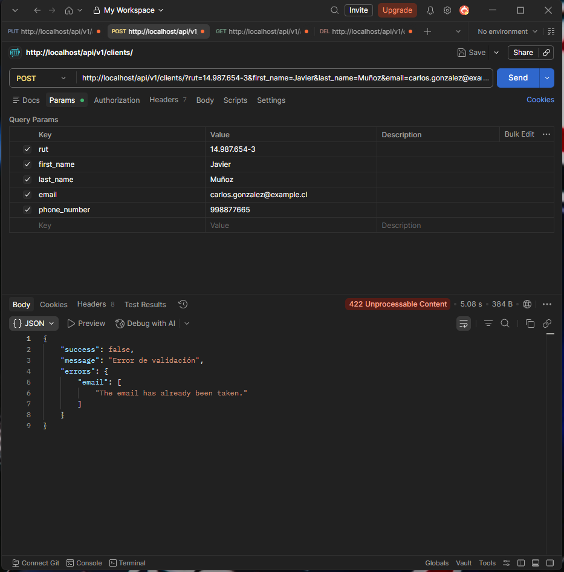

# **Evaluación 2**
### Fase A: Persistencia (Base de Datos).
### Migracion
Para crear una migracion, necesitamos ocupar ```php artisan make:migration``` junto con el nombre de la tabla, en este caso quedaria: ```php artisan make:migration create_table_clients```.

Definimos la migracion segun lo requerido, en este caso quedaria:
```PHP
    public function up(): void
    {
        Schema::create('clients', function (Blueprint $table) {
            $table->id('id');
            $table->string('rut', 12)->unique();
            $table->string('first_name', 50);
            $table->string('last_name', 50);
            $table->string('email', 100)->unique();
            $table->string('phone_number', 20)->nullable();
            $table->timestamps();
        });
    }
```
Una vez finalizado de definir la tabla y su estructura, ocupamos ```php artisan migrate``` para aplicar la tabla en la base de datos.

### Fase B: Desarrollo del Servicio (Laravel API).
### Controlador
Para crear un controlador,  necesitamos ocupar ```php artisan make:controller```, definimos el nombre del controlador, en este caso es ```ClientsController``` y le pasamos el parametro ``` --resource ``` para generar automáticamente los métodos básicos de un CRUD. Finalmente el comando quedaria: ```php artisan make:controller ClientsController --resource```.
En este caso, se crearon 7 funciones, pero solamente ocuparemos las siguientes:
* Esta funcion se encargara de extraer todos los clientes.
```
public function index(): JsonResponse
```
* Esta funcion se encarga de registrar un cliente.
```
public function store()
```
* Esta funcion se encargara de extraer un cliente segun la id.
```
public function show()
```
* Esta funcion se encargara de actualizar la informacion del cliente.
```
public function update
```
* Esta funcion se encargara de eliminar un cliente.
```
public function destroy
```

### Modelo
Para crear un modelo, necesitamos ocupar ```php artisan make:model``` y el nombre del modelo, en este caso es ```Client```.
Finalmente el comando quedaria ```php artisan make:model Client```.

En este caso, el modelo del cliente quedaria de la siguiente manera:
```php
class Client extends Model
{
    protected $primaryKey = 'id';

    protected $fillable = [
        'rut',
        'first_name',
        'last_name',
        'email',
        'phone_number',
    ];
}
```

# **Endpoints**

### Crea un cliente
```Route::post('v1/clients', [ClientsController::class, 'store']);```



### Extrae a todos los clientes
```Route::get('v1/clients', [ClientsController::class, 'index']);```



### Extrae a un cliente por id
```Route::get('v1/clients/{id}', [ClientsController::class, 'show']);```



### Actualiza un cliente por id
```Route::put('v1/clients/{id}', [ClientsController::class, 'update']);```



### Elimina un cliente por id
```Route::delete('v1/clients/{id}', [ClientsController::class, 'destroy']);```



### Fase C: Validación y Contrato (Postman).

En este caso, se creo un usuario con email carlos.gonzalez@example.cl anteriormente, para este ejemplo crearemos otro usuario pero con el mismo correo, pero nos muestra un error 422 con un error de validacion y nos muestra que el email ya esta registrado



#### INTEGRANTES: Luis Hernandez
